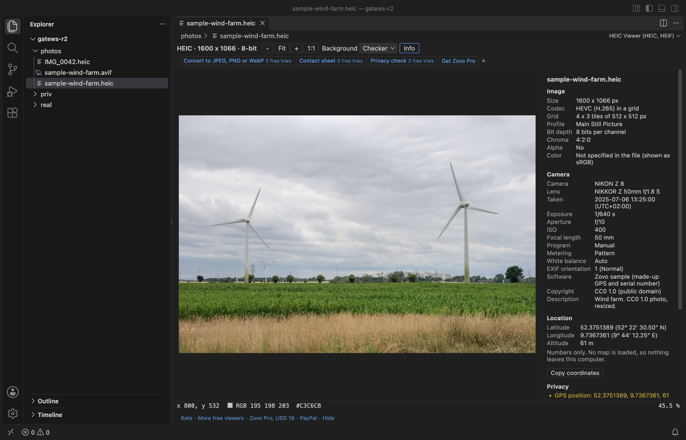

# HEIC Viewer & AVIF Viewer

Open iPhone HEIC photos, HEIF and AVIF images in a VS Code tab: click the file and the photo shows, with its size, camera data and GPS position next to it. Works offline, with nothing to install. Made by Zovo.

Free, with no account and no network calls:

- HEIC and HEIF photos from iPhones, Android phones and cameras (.heic, .heif, .hif), including 10-bit files and photos stored as a grid of tiles.
- AVIF images (.avif), decoded by the editor's own image decoder, with the same info panel. VS Code opens .avif in its built-in image preview by default; right-click the file and choose Open in HEIC Viewer, or make it the default with Reopen Editor With.
- Rotation, mirroring and crop applied the way the file says. Display P3 photos keep their colors.
- Bursts, stereo pairs and other files with several images get an Image picker; the arrow keys step through them.
- Zoom, pan, fit and 1:1, the RGB value under the cursor, a checker, black, gray or white background.
- Info panel: size, codec, bit depth, chroma, color profile, alpha, depth map, thumbnails.
- Camera, lens, exposure, ISO and date from the EXIF (or the XMP when a photo has no EXIF), and every EXIF tag in a list.
- The GPS position as plain numbers, with Copy coordinates. No map is loaded.

Zovo Pro: USD 19 once, for the Pro tools in every Zovo extension. Each Pro tool has 3 free tries on your computer first:

- Convert to JPEG, PNG or WebP: one photo or a whole folder, with quality, size and a metadata choice (keep EXIF, keep it without GPS and serial numbers, or remove it), plus a report.
- Contact sheet: every photo of a folder on A4 pages with file names and dates, saved as a PDF or PNG pages.
- Privacy check: every photo in a folder that holds a GPS position, a camera or lens serial number or an owner name, and one step to remove them, in place or as cleaned copies, without touching the image data.

## How to use it

- Click a `.heic`, `.heif` or `.hif` file in the Explorer. For `.avif` files, or when another viewer opens the file, right-click it and choose Open in HEIC Viewer, or use Open With.
- To zoom, use Ctrl or Cmd + mouse wheel, the + and - buttons, or the keys `+`, `-`, `0` (fit) and `1` (actual size). Drag to pan. Double-click copies the color under the cursor.
- `I` shows or hides the info panel. Left and right arrows step through the images of a multi-image file.
- To try it without a photo of your own, run HEIC Viewer: Open the Sample HEIC Photo from the Command Palette. Its GPS position and serial number are made up.
- The Pro tools are in the Command Palette (HEIC Viewer: ... (Pro)), in the Explorer right-click menu for photos and folders, and in the small row at the end of the viewer toolbar. The row closes with its x for the rest of the session, and the setting `heicViewer.showProTools` hides it for good.

## What it reads

| File | What shows |
|---|---|
| HEIC, HEIF, HIF with HEVC (H.265) | Every still image, grids, overlays, derived images, alpha, 8 and 10-bit (shown at 8 bits) |
| AVIF | The primary image, 8 to 12-bit, alpha, grids, rotation; animated AVIF shows its first frame |
| EXIF and XMP | Camera, lens, exposure, date, GPS, serial numbers, owner names, every EXIF tag |

HEIF files that use VVC (H.266), JPEG 2000 or other codecs open with their details and a note that the pixels are not decoded in this version. HDR photos are shown in 8 bits without tone mapping, so bright areas look flat.

## Privacy

The extension reads the file you open and nothing else. It makes no network calls, and nothing is uploaded or measured. The GPS position is shown as numbers only; no map or tile server is contacted. The Pro tools write only the files you ask for, and the privacy check changes a photo only after you confirm. The links at the bottom of the viewer (Rate, More free tools, Zovo Pro) open a page only when you click them, and the setting `heicViewer.showSupportLinks` hides them.

## Settings

| Setting | Default | What it does |
|---|---|---|
| `heicViewer.maxFileSizeMB` | 300 | Larger files open with a message instead of the image. |
| `heicViewer.quality` | 90 | JPEG and WebP quality for the converter. |
| `heicViewer.sheetColumns` | 4 | Photos per row on a contact sheet page. |
| `heicViewer.showProTools` | true | Shows the Pro tools in menus, the palette and the toolbar row. |
| `heicViewer.showSupportLinks` | true | Shows the Rate, More free tools and Zovo Pro links. |
| `heicViewer.askForRating` | true | Asks once for a rating after two good uses at least 30 minutes apart. |

## Zovo Pro

One payment of USD 19 unlocks the Pro tools in every Zovo extension on your computers; a team of 5 is USD 59. The key works offline. Run Zovo Pro: Get Zovo Pro from the Command Palette, or click Get Zovo Pro in the toolbar row. The Zovo Pro tab lists this extension's Pro tools and your free tries before any payment page opens.

## License

MIT, by Zovo. HEIC decoding uses libheif and libde265 (LGPL-3.0), shipped unmodified as a separate WebAssembly file; see THIRD-PARTY-NOTICES.md. The sample photo is CC0 1.0.
